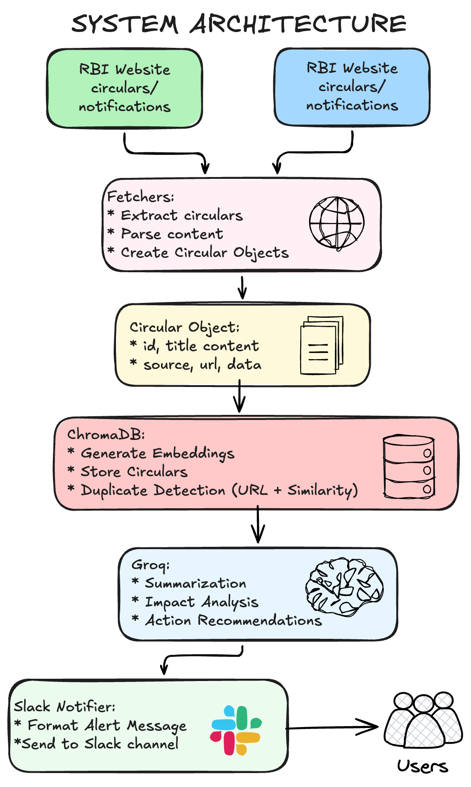
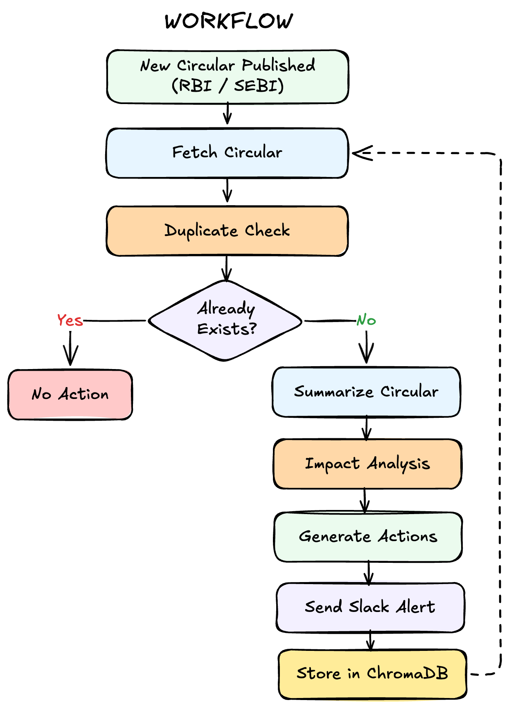
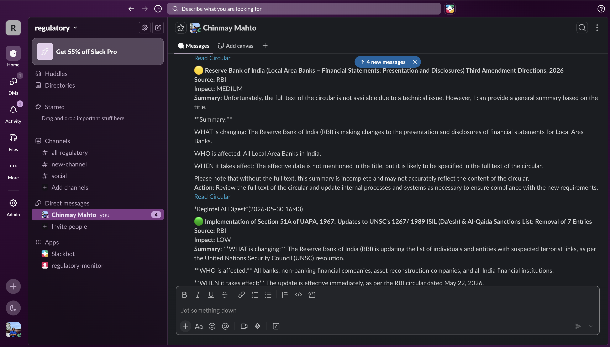

# RegIntel AI

> **Status: v2 in progress (W0 complete).**
> v1 — fetch, summarise, score, Slack — is archived under `legacy/` and is no longer the product.
> v2 is a multi-tenant compliance copilot: connect your policies, see which regulations bind you,
> what went stale, and what to edit. Run `make help` for the available targets. Internal planning
> notes are kept outside this repository on purpose.
>
> ```
> make setup   # create .venv, install pinned deps
> make test    # offline test suite, no network or API calls
> make eval    # intentionally fails until W2
> make audit   # pip-audit on pinned deps
> ```


## Data ingestion (W1)

Requires Postgres with the `vector` extension:

```bash
brew services run postgresql@18     # start, without registering at login
createdb regintel                   # once
make db-init                        # apply sql/001_init.sql
```

### Where the text comes from

| Source | Route | What we get |
| --- | --- | --- |
| RBI | `BS_CircularIndexDisplay.aspx?Id=…` detail pages, HTML | full text as paragraphs, no page geometry |
| SEBI | listing -> detail page -> `sebi_data/attachdocs/*.pdf` | full text with page and bbox |

RBI's PDF host (`rbidocs.rbi.org.in`) sits behind a bot check that serves a CAPTCHA page to
automated clients. The HTML detail page carries the same circular text and is not blocked, so RBI
is ingested from HTML and its `pdf_url` is recorded for provenance only. SEBI PDFs download fine
and keep full geometry.

### Commands

```bash
make ingest                                   # backfill RBI 2023-01..now + SEBI page 1
make daily                                    # one incremental pass (current + previous month)
.venv/bin/python -m app.ingest.run --source rbi --start 2025-01 --end 2025-03 --limit 20
.venv/bin/python -m app.ingest.run --source sebi --limit 5
.venv/bin/python -m app.ingest.run --source dir --dir ~/Downloads/rbi-circulars
.venv/bin/python -m app.ingest.run --dry-run  # parse, do not write
```

`make schedule` installs a launchd job that runs the incremental pass every day at 06:00 and logs to
`data/logs/`. `make unschedule` removes it.

### Storage

Raw PDFs are **not** archived. For each document we keep:

- the parsed clauses in Postgres (text, section number, heading path, page, bbox, spans),
- one gzipped snapshot of the source HTML/PDF in `data/raw/<sha256>.gz` (~17 KB average),
- the `pdf_url`, so the original can be re-fetched if ever needed.

Measured on 86 documents / 2,396 clauses: 1.6 MB of snapshots and 9.5 MB of Postgres — about
110 KB per document in the database and 17 KB on disk, versus ~350 KB for the raw PDF alone.
PDFs are already internally compressed, so gzipping them saves almost nothing; the saving comes
from not storing them at all.

v1 description, kept for reference:

AI powered regulatory monitoring system that automatically tracks RBI and SEBI circulars, identifies new updates, summarizes them using LLMs, scores their business impact, and delivers actionable alerts to Slack.

---

## The Problem:

Regulatory teams, compliance officers, risk teams, and financial institutions face a constant stream of circulars, notifications, and policy updates from regulators such as RBI and SEBI.

The challenges are:

* Regulations are published across multiple sources.
* Teams must manually monitor websites for updates.
* Important circulars can be missed.
* Reading lengthy documents consumes significant time.
* Determining business impact requires domain expertise.
* Different stakeholders need different levels of detail.

As the volume of regulatory updates grows, manual monitoring becomes inefficient and error prone.

---

## Solution

RegIntel AI automates the entire monitoring workflow.

The system:

1. Fetches the latest circulars from RBI and SEBI.
2. Detects whether a circular is new or already processed.
3. Extracts and stores circular content.
4. Uses LLMs to generate concise summaries.
5. Performs impact analysis and recommends actions.
6. Sends digest style notifications to Slack.
7. Runs automatically on a schedule.

This reduces the time required to review regulatory updates from hours to minutes.

---

## Key Features

### Regulatory Monitoring

* RBI circular monitoring
* SEBI circular monitoring
* Automatic content extraction
* Scheduled checks

### Duplicate Detection

* URL based deduplication
* ChromaDB vector storage
* Embedding powered similarity search

### AI Analysis

* Regulatory summarization
* Impact classification
* Affected entity identification
* Recommended actions

### Notifications

* Slack integration
* Automated digest generation

### Automation

* APScheduler based execution
* Fully automated monitoring pipeline

---

## System Architecture

<p align="center">
  
</p>

---

## Project Structure

```text
regulatory-monitor/

├── app/
│   └── fetchers/          # live code in v2
│       ├── base.py        # Circular, url allowlist, capped fetch
│       ├── rbi.py
│       └── sebi.py
│
├── legacy/                # archived v1 pipeline, not runnable as-is
│   ├── chains/
│   ├── notifier/
│   ├── store/
│   ├── scheduler.py
│   └── run_scheduler.py
│
├── scripts/
│   ├── eval.py            # eval gate, fails until W2
│   └── manual/            # exploratory scripts, never run by pytest
│
├── tests/                 # offline only
├── evals/                 # eval datasets (.jsonl)
│
├── Makefile
├── requirements.txt
├── requirements-dev.txt
├── requirements-legacy.txt
├── pytest.ini
└── .env.example
```

---

## Tech Stack

### Backend

* Python

### AI

* Groq
* Llama 3.1
* LangChain

### Vector Database

* ChromaDB

### Embeddings

* sentence-transformers
* all-MiniLM-L6-v2

### Data Collection

* Requests
* BeautifulSoup

### Scheduling

* APScheduler

### Notifications

* Slack Incoming Webhooks

---

## Example Workflow

<p align="center">
  
</p>

---

## Sample Alert

```text
🔴 Reserve Bank Circular

Source: RBI

Impact: HIGH

Summary:
New governance requirements introduced for regulated entities.

Action Required:
Review compliance procedures and update internal controls.

Read Circular
```

---

## Setup

### Clone Repository

```bash
git clone <repository-url>
cd regulatory-monitor
```

### Create Virtual Environment

```bash
uv venv
source .venv/bin/activate
```

### Install Dependencies

```bash
uv pip install -r requirements.txt
```

### Configure Environment Variables

Create a `.env` file:

```env
GROQ_API_KEY=your_key
SLACK_WEBHOOK_URL=your_webhook
CHROMA_DB_PATH=./data/chroma_db
```

### Run Once

```bash
python -m app.scheduler
```

### Run Continuously

```bash
python -m app.run_scheduler
```

---

## Example Slack Alert



---

## Current Status

### Version 1.0

Implemented:

* RBI monitoring
* SEBI monitoring
* ChromaDB storage
* Duplicate detection
* AI summarization
* Impact scoring
* Slack alerts
* Automated scheduling

---

## Plan for Version 2

### Conversational Regulatory Assistant

Ask questions such as:

* What changed this week?
* Show all RBI updates affecting NBFCs.
* Which circulars require immediate action?

### RAG

* Search historical circulars
* Semantic retrieval
* Source grounded answers

### Voice Agent

* Call based compliance briefing
* Weekly executive summaries
* Interactive voice Q&A

### Email Digests

* Daily digest
* Weekly digest
* Executive reports

### Web Dashboard

* Circular explorer
* Search and filtering
* Trend analysis
* Compliance tracking

---